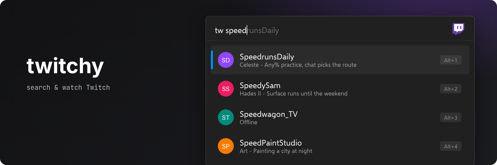

<!-- generated by readwright from docs/README.md.j2; edit the template, not this file -->


# Twitchy

Search, browse and watch Twitch from Flow Launcher.

[](https://github.com/Garulf/twitchy/actions/workflows/tests.yml) [](https://github.com/Garulf/twitchy/releases/latest) [](https://github.com/Garulf/twitchy/releases/latest)

[](https://www.buymeacoffee.com/garulf) [](https://github.com/sponsors/Garulf)

## Features

* **Search channels.** Live channels show the game and stream title, offline ones say so.
* **Browse top games.** `tw :` lists the most watched games, `tw :celeste` filters them.
* **Open in your browser.** `Enter` opens the channel or game on twitch.tv.
* **Open in your own player.** Point Twitchy at mpv, VLC or any program and open streams from the context menu.

## Usage

Type `tw` followed by a channel name:

```
tw speed
```


| Query | Result |
| --- | --- |
| `tw <name>` | Channels matching the name |
| `tw :` | The top games on Twitch |
| `tw :<name>` | Top games whose name contains the text |
| `tw` | Live streams from channels you follow (needs a username, see below) |
| `tw #` | Channels you follow (needs a username, see below) |

### Top games


### Open a stream in another program

Set **Program Path** in the settings, then open the context menu (`Shift+Enter` or right-click) on a channel:


**Program Arguments** can use these placeholders. Without arguments the program gets the channel URL.

| Placeholder | Value |
| --- | --- |
| `{url}` | The channel URL, for example `https://twitch.tv/speedrunsdaily` |
| `{best}` | The best quality stream URL, resolved with streamlink |
| `{worst}` | The lowest quality stream URL, resolved with streamlink |

## Installation

### Flow Launcher

In Flow Launcher, type:

```
pm install twitchy
```


### Manual installation

Download `twitchy-<version>.zip` from the [latest release](https://github.com/Garulf/twitchy/releases/latest) and unzip it into
`%appdata%\FlowLauncher\Plugins`, then restart Flow Launcher.

Pre-releases of the next version are published from the open release PR on the
[releases page](https://github.com/Garulf/twitchy/releases) for testing. Flow Launcher won't offer them as updates.

## Configuration

Twitchy needs a Twitch application to talk to the Twitch API. Creating one takes a few minutes:

1. Turn on [two-factor authentication](https://www.twitch.tv/settings/security) for your Twitch account. The developer console requires it.
2. Open the [Twitch developer console](https://dev.twitch.tv/console/apps) and click **Register Your Application**.
3. Give it any unique name, add `http://localhost` as the OAuth Redirect URL, pick a category and click **Create**.
4. Click **Manage** on the new application. Copy the **Client ID**, then click **New Secret** and copy the **Client Secret**.
5. In Flow Launcher, open **Settings → Plugins → Twitchy** and paste both. Leave **OAuth Token** empty.

The first search fetches an app access token with your client ID and secret and saves it in **OAuth Token**.
When it expires, Twitchy fetches a new one.

| Setting | Description |
| --- | --- |
| Client ID | The client ID of your Twitch application |
| Client Secret | The client secret of your Twitch application |
| OAuth Token | Filled in for you. You can paste your own token instead, but Twitchy still needs the client ID |
| Username | Your Twitch username, for the followed channels queries |
| Program Path | A program to open streams with, such as `C:\Program Files\mpv\mpv.exe` |
| Program Arguments | Arguments for that program, see the placeholders above |

### Followed channels

The `tw` and `tw #` queries used Twitch's Get Users Follows endpoint, which
[Twitch removed in September 2023](https://dev.twitch.tv/docs/change-log/). Until Twitchy moves to its
replacement, which needs a user token, those two queries show an error when a username is set.

## Requirements

* Flow Launcher 1.17.0 or newer
* Python 3.10 or newer, which Flow Launcher can install for you
## Changelog

### [8.0.0](https://github.com/Garulf/twitchy/compare/v7.0.0...v8.0.0) (2026-11-17)

#### ⚠ BREAKING CHANGES

* the plugin now runs on Flow Launcher's python_v2 runtime and needs Python 3.10 or newer.

#### Features

* port to pyflowlauncher on the python_v2 runtime ([f931bb7](https://github.com/Garulf/twitchy/commit/f931bb76cb2f506eeabfed167d17aad1097e7eb8))

#### Bug Fixes

* fall back to the stream URL when program arguments are blank ([2ce2e1c](https://github.com/Garulf/twitchy/commit/2ce2e1c2f1d7b7c604cf982507816aadf28e8cc6))
* look up users and streams in batches of 100 ids ([5384aa5](https://github.com/Garulf/twitchy/commit/5384aa5f91c6294252915aa44f94b4a27036ebe8))
* skip the program entry when a channel has no live stream ([e465de1](https://github.com/Garulf/twitchy/commit/e465de13b15c45916b086706a505637bba348e64))

See [CHANGELOG.md](CHANGELOG.md) for the full history.
